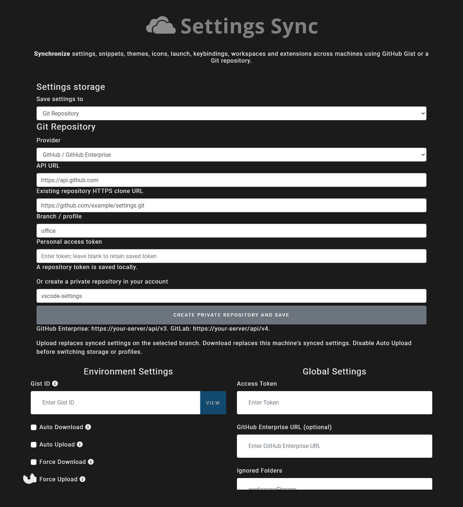

# Git repository settings sync

Settings Sync can use GitHub Gist or an HTTPS Git repository on GitHub, GitLab,
GitHub Enterprise Server, or GitLab Self-Managed. Git must be installed and
available to VS Code. Existing installations continue using Gist by default.

## Setup

1. Open **Sync: Advanced Options → Sync: Open Settings**. Turn off Auto Upload
   while changing storage. Under **Settings storage**, select **Git Repository**.
2. Choose the provider, enter its API URL and a personal access token, then paste
   the HTTPS `.git` clone URL of an existing repository. Alternatively, enter a
   repository name and click **Create private repository and save** to create
   one in your personal account. API defaults are `https://api.github.com` and
   `https://gitlab.com/api/v4`; Enterprise URLs are typically
   `https://github.example.com/api/v3` or `https://gitlab.example.com/api/v4`.
3. Choose a branch/profile, such as `master` or `office`, save, then run **Sync:
   Update / Upload Settings** on the source machine or **Sync: Download Settings**
   on another machine. A missing branch is created on its first upload.

For GitHub, a classic personal access token needs `repo` access for private
repositories; organization SSO policies may require additional authorization.
For GitLab, use a personal access token with `api` and `write_repository` access
for repository creation and Git upload/download. The account must have access
to the chosen repository. Gist authorization is separate from repository access.

The selected provider, URL, branch and token are saved in Sync Global Settings
(`syncLocalSettings.json`). Tokens stay local and are not copied into Git
configuration, committed, or sent back to the settings webview. Leaving the token
field blank retains it; changing provider/server requires a new token. Reset
Settings Sync to clear its saved configuration and credentials.

## Upload, download and profiles

- Upload commits the current synced files and pushes to the selected branch. It
  uses an explicit `--force-with-lease` expectation: a concurrent remote change
  causes an error instead of silently overwriting someone else's work. Download
  and retry after reviewing such a change.
- Download fetches the selected branch and resets a temporary checkout to it,
  then applies files through the existing settings/extension/snippet pipeline.
  Force Download bypasses the timestamp shortcut. The extension does not reset
  a user's project checkout or delete unrelated local settings files.
- Switch `master` to `office` in the same UI to use another profile. The selected
  branch persists across restarts; switching branches clears timestamp shortcuts.
  Download the new profile before enabling Auto Upload.
- Repositories contain `settings/`, `custom-files/`, and a
  `.settings-sync-manifest.json` listing files owned by Settings Sync. Unrelated
  files, such as README files, are preserved. Existing untracked-by-manifest
  files are never silently adopted or overwritten.
- Select **GitHub Gist** and save to return to Gist. Configure its existing Gist
  ID/token fields as usual. `.git` directories and `syncLocalSettings.json` are
  excluded from uploads regardless of ignore-list changes.



## Verification

After dependency installation and VS Code type setup, run:

```sh
npx tsc --pretty false
npx mocha out/test/service/repository/repository.test.js
node test/service/repository/pipeline-smoke.js
```

The integration tests use temporary local bare Git repositories and mocked
provider API responses. The pipeline smoke test mocks the VS Code shell while
using the real file collection, Git operations and import code. No real account
or token is required. These tests do not verify a live GitHub/GitLab server.

For Extension Host verification, start the extension with F5, configure a test
repository, upload a setting and a nested snippet, change both locally, and
force-download. Check both profiles independently, repeat with a GitLab or
Enterprise server, then switch to Gist and confirm Git metadata is excluded.
Also check repository creation, expired tokens and Auto Upload after a restart.
